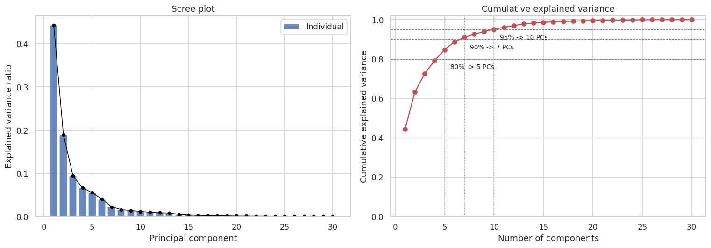
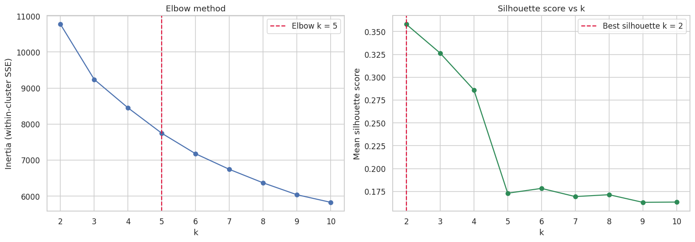
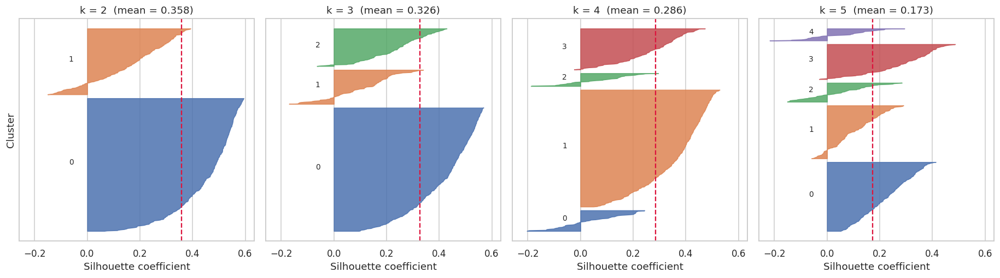
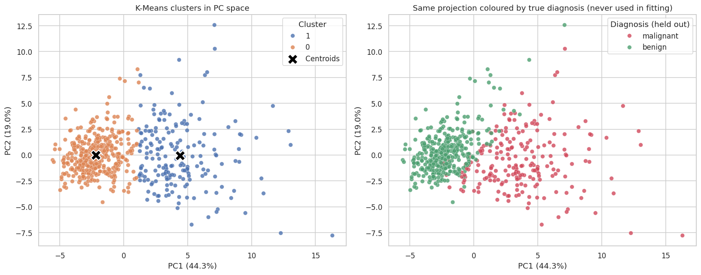
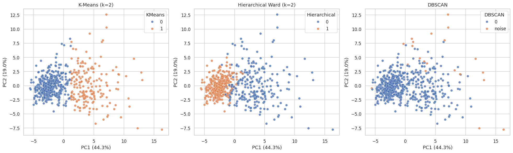
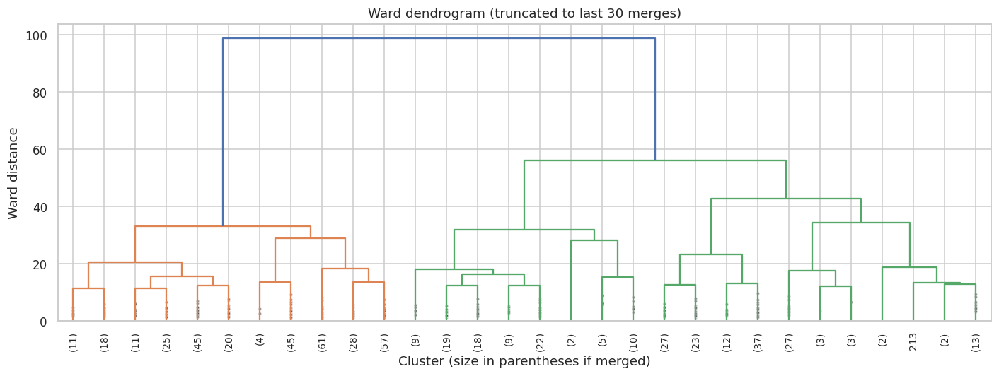

# Dimensionality Reduction & Unsupervised Clustering

Applying **PCA** and three unsupervised clustering algorithms (**K-Means, Hierarchical, DBSCAN**) to discover structure in a 30-dimensional dataset.

## Dataset

Wisconsin Breast Cancer diagnostic data from scikit-learn: 569 samples x 30 numeric features. The diagnosis label (benign / malignant) is **never used for fitting**. It is held out and used only to validate the discovered clusters.

## Pipeline

1. Standardize features (`StandardScaler`)
2. PCA with scree plot and cumulative explained variance to choose the number of components
3. K-Means with elbow method and silhouette analysis (including per-sample silhouette plots) to choose *k*
4. 2D / 3D cluster visualization with Seaborn and Plotly
5. Hierarchical clustering (Ward dendrogram) and DBSCAN (k-distance plot, eps / min_samples grid search)
6. Side-by-side comparison with internal metrics and an external check against the held-out diagnosis

## Key results

| Step | Result |
|---|---|
| PCA | 10 components retain **95.2%** of variance (30 -> 10 dims). Kaiser criterion suggests 6. |
| K-Means | Best silhouette at **k = 2 (0.358)**; elbow curve ambiguous |
| Hierarchical (Ward) | k = 2, silhouette 0.296, ARI 0.70 vs diagnosis |
| DBSCAN | Could not split the data into balanced clusters (see below) |
| K-Means vs diagnosis | ARI 0.67; 343/380 of cluster 0 benign, 175/189 of cluster 1 malignant |

### PCA scree plot


### Elbow method and silhouette score


### Per-sample silhouette plots


### K-Means clusters in PCA space


### Algorithm comparison


### Hierarchical dendrogram


## A note on DBSCAN

DBSCAN did not work well on this dataset, and the notebook documents that rather than forcing a result. Across the whole eps x min_samples grid, no setting produced two or more balanced clusters with an acceptable amount of noise. Benign and malignant samples form one continuous density region, so a density threshold cannot separate them, whereas centroid and variance based methods can. DBSCAN is still useful here as an outlier detector.

## Run it locally

```bash
git clone https://github.com/<your-username>/<your-repo>.git
cd <your-repo>
python -m venv .venv
source .venv/bin/activate        # Windows: .venv\Scripts\activate
pip install -r requirements.txt
jupyter notebook pca_clustering.ipynb
```

## Tech stack

Python, scikit-learn, SciPy, pandas, NumPy, Seaborn, Matplotlib, Plotly


